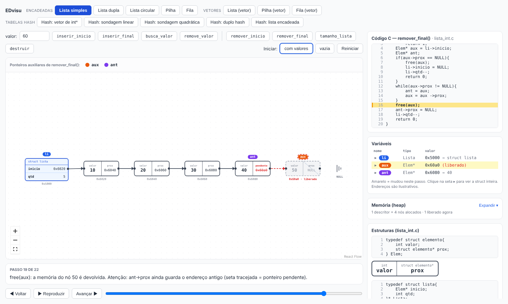
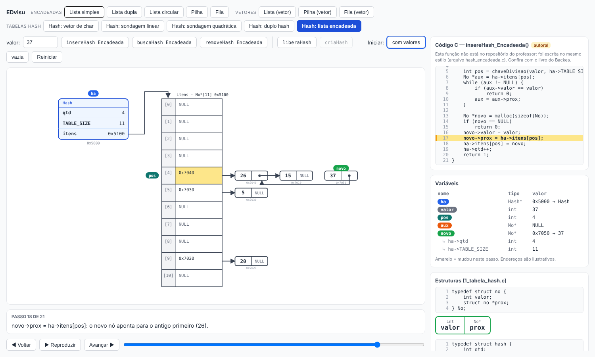

# EDvisu — Visualizador de Estruturas de Dados

Projeto acadêmico (UNICAP) que mostra, **passo a passo**, o que acontece na memória quando um código em C manipula uma estrutura de dados. A cada passo, a tela exibe o código C com a linha em execução, as variáveis locais, os ponteiros e a estrutura desenhada como nós e setas.





## O que já funciona

Catorze estruturas, em três grupos de abas no topo da tela. O código C exibido é o da disciplina (`estruturas-de-dados/` do repositório do professor) sempre que ele existe; o que **não** existe no repositório foi escrito pelo EDvisu e aparece com o selo **autoral** (veja "Procedência do código C").

**Encadeadas** (nós + ponteiros, memória dinâmica)

| Estrutura | Funções com passo a passo |
|---|---|
| Lista simples | `inserir_inicio`, `inserir_final`, `remover_inicio`, `remover_final`, `tamanho_lista`, `busca_valor`*, `remove_valor`*, `destruir` |
| Lista dupla | as mesmas, com `prox`, `ant`, `inicio` e `final` |
| Lista circular | `inserir_inicio`, `inserir_final`, `busca_valor`*, `remove_valor`*, `destruir`* (as demais são funções vazias no repositório) |
| Pilha dinâmica (vertical, topo em cima) | `push`, `pop`, `peek`, `size`, `destruir` |
| Fila dinâmica | `enqueue`, `dequeue`, `destruir`* |

**Vetores** (array dentro da struct)

| Estrutura | Funções com passo a passo |
|---|---|
| Lista (vetor) — toda autoral | `inserir_inicio`, `inserir_final`, `remover_inicio`, `remover_final`, `tamanho_lista`, `busca_valor`, `remove_valor`, `destruir` |
| Pilha (vetor) | `push`, `pop`, `peek`, `tamanho_pilha`, `destruir_pilha` |
| Fila (vetor circular) | `enqueue`, `dequeue`, `peek`, `tamanho`, `destruir` (no repositório: `inserir`, `remover`, `acessar`; o EDvisu usa os nomes padrão e avisa no painel de código) |

**Tabelas hash** (todas com 11 posições; as quatro primeiras guardam o valor dentro da célula do vetor)

| Estrutura | Funções com passo a passo |
|---|---|
| Hash: vetor de `char` (sem tratamento de colisão) | `insereHash_SemColisao_Rejeita`*, `insereHash_SemColisao_Sobrescreve`*, `buscaHash_SemColisao`*, `removeHash_SemColisao`*, `liberaHash`*, `criaHash`* (com `chaveDivisao` do repositório mostrada como função chamada) |
| Hash: sondagem linear (vetor de `int`) | `insereHash_SondagemLinear`*, `buscaHash_SondagemLinear`*, `removeHash_SondagemLinear`*, `liberaHash`*, `criaHash`*, mais a função `sondagemLinear` dos slides |
| Hash: sondagem quadrática | as mesmas, com `sondagemQuadratica` (`pos + 2*i + 5*i*i`, como nos slides) |
| Hash: duplo hash | as mesmas, com `duploHash` (`H2 = chaveDivisao(chave, TABLE_SIZE-1) + 1`, como nos slides) |
| Hash: lista encadeada | `insereHash_Encadeada`*, `buscaHash_Encadeada`*, `removeHash_Encadeada`*, `liberaHash`*, `criaHash`* |

\* função autoral (não está no repositório do professor).

A hash de `char` aceita **um** caractere (letra ou dígito); a chave é o código ASCII e a posição é `código % 11`. Ela é a hash do repositório (sem colisão, com `Rejeita` e `Sobrescreve`) reescrita com vetor de `char`; a versão original com `int **itens` não faz parte do EDvisu.

As hashes de sondagem seguem os slides da aula, com vetor de `int` (chaves inteiras >= 0): posição vazia é `VAZIO` (-1, o "NULL" dos slides) e a remoção grava `REMOVIDO` (-2), para não quebrar a busca de outras chaves. A inserção guarda a primeira posição livre ou removida (`livre`) e só para ao achar uma posição vazia, assim não cria repetidos. Na sondagem quadrática dos slides (`2*i + 5*i*i` com `TABLE_SIZE = 11`) as posições se repetem, então a inserção pode falhar mesmo com espaço sobrando (propriedade da fórmula, não defeito do EDvisu). Na hash encadeada cada posição aponta para uma lista: o novo nó entra no início da cadeia.

Lista dupla e lista circular **não** têm versão em vetor: com vetor, a dupla vira a própria lista sequencial (não há `ant`) e a circular vira a fila circular, que já existe.

Na tela:

- **Passo a passo nos dois sentidos:** Voltar/Avançar, slider, reprodução automática e setas ← → do teclado.
- **Painel de código:** a função inteira no topo da coluna lateral, com a linha em execução destacada e a rolagem acompanhando a execução. A numeração sempre começa em 1 dentro de cada função ou struct.
- **`free()` visível:** o nó liberado fica cinza e tracejado ("liberado") por um passo, e ponteiros que ainda apontam para ele aparecem como seta vermelha tracejada. No passo seguinte ele some.
- **Ponteiros auxiliares (`no`, `aux`, `ant`):** além da etiqueta colorida sobre o nó, a faixa acima do desenho mostra um pontinho quando o ponteiro é criado (anel verde), quando está declarado sem valor (pontinho vazado) e quando sai de escopo (cinza riscado, "removida").
- **Painel de variáveis expansível:** a seta ▸ de cada ponteiro abre a struct completa para onde ele aponta.
- **Painel Memória (heap) expansível:** lista todos os objetos alocados com todos os campos, destacando o que mudou.
- **NULL sem caixa:** NULL não é um objeto, então aparece como o símbolo de terra (⏚) onde a seta termina, e o campo de ponteiro que vale NULL fica riscado na diagonal.
- **Tela responsiva:** o visualizador ocupa a janela inteira do navegador e o desenho se reenquadra sozinho.
- **Iniciar com valores ou vazia:** os botões "com valores" / "vazia" / "Reiniciar" recomeçam qualquer estrutura do estado escolhido.
- **`destruir` / `liberaHash`:** cada nó (ou, nas hashes, o vetor) é liberado, depois o descritor. A struct fica cinza "liberado", a variável do chamador fica pendente e as demais funções são bloqueadas até reiniciar (nas hashes, `criaHash` recria a tabela).
- **Vetores:** células com índice, marcadores `topo`/`inicio`/`final`/`i`, e posições fora da estrutura em cinza tracejado (lixo ou valor antigo que continua na memória depois de um `pop` ou `remover`).
- **Falha de segmentação:** `remover_inicio` da lista dupla trava no código original quando há um único nó (`li->inicio->ant` com `li->inicio == NULL`). O visualizador mostra o travamento em vez de esconder o erro.

> Os endereços mostrados (`0x6040`, etc.) são **ilustrativos**, gerados a partir do id do nó.

## Como rodar

Requisito: **Docker**, ou Node.js 20.19+ / 22.12+ instalado na máquina.

### Com Docker (não precisa instalar Node)

Na pasta do projeto:

```bash
# Windows (cmd)
docker run -it --rm -p 5173:5173 -v "%cd%":/app -w /app --entrypoint sh node:24-alpine

# Windows (PowerShell)
docker run -it --rm -p 5173:5173 -v "${PWD}:/app" -w /app --entrypoint sh node:24-alpine

# Linux / macOS
docker run -it --rm -p 5173:5173 -v "$(pwd)":/app -w /app --entrypoint sh node:24-alpine
```

Dentro do container:

```bash
npm install
npm run dev -- --host
```

Abra <http://localhost:5173>. O `--host` é necessário para o navegador acessar o servidor de dentro do container.

Para sair do container: `Ctrl+C` (para o servidor) e `exit`. Os arquivos ficam na sua pasta por causa do volume (`-v`).

### Sem Docker

```bash
npm install
npm run dev
```

### Observações

- **Atualização automática no Windows:** o `vite.config.ts` usa `server.watch.usePolling`, porque volumes do Docker no Windows não avisam o Vite quando um arquivo muda.
- **`node_modules` é da plataforma onde foi instalado:** o instalado dentro do container (Linux) não funciona no Node do Windows. Rode os comandos `npm` sempre no mesmo ambiente.
- **Build de produção:** `npm run build` gera a pasta `dist/`.

## Stack

- [React](https://react.dev/) + [Vite](https://vite.dev/) + TypeScript (`App.tsx`); os componentes do visualizador estão em JavaScript (`.jsx`)
- [React Flow](https://reactflow.dev/) (pacote `reactflow`, versão 11) para nós e arestas

## Como o código está organizado

A tela **nunca calcula nada sozinha**: ela só desenha um *snapshot* por vez. Um snapshot é uma foto do estado da memória e da execução naquele instante. Avançar e voltar é só trocar o índice do snapshot exibido.

```
src/
├── memoryModel.js            Modelo da memória (nós, descritor, free) + gravador de passos + contrato do snapshot
├── arrayModel.js             Modelo da memória dos vetores e da hash + gravador de passos
├── ArrayView.jsx             Desenho dos vetores (HTML) e da hash (SVG) + painel de variáveis dos vetores
├── structures/
│   ├── index.js              Catálogo das estruturas (abas da tela, em grupos)
│   ├── simpleList.js         Lista simples: um gerador de passos por função C
│   ├── doublyList.js         Lista dupla
│   ├── circularList.js       Lista circular
│   ├── stack.js              Pilha dinâmica
│   ├── queue.js              Fila dinâmica
│   ├── valueOps.js           busca_valor, remove_valor e destruir das estruturas encadeadas
│   ├── listVet.js, stackVet.js, queueVet.js   Estruturas com vetor
│   ├── arrayOps.js           Passos da lista/pilha/fila em vetor
│   ├── hashTable.js, hashCharOps.js      Hash sem colisão com vetor de char
│   ├── hashOpenTables.js, hashOpenOps.js Hash de sondagem (linear, quadrática, duplo hash)
│   ├── hashChain.js, hashChainOps.js     Hash com lista encadeada
│   ├── listCommon.js         Funções idênticas em mais de uma estrutura (tamanho_lista)
│   └── listings/             Código C real (GERADO por tools/gen-listings.mjs)
├── snapshotToFlow.js         Snapshot -> nodes/edges do React Flow
├── LinkedListNode.jsx        Nós desenhados: descritor, Elem e NULL
├── Panels.jsx                Código, variáveis, memória, structs e a faixa de ponteiros auxiliares
├── useStepper.js             Lista de passos + índice atual (avançar, voltar, reproduzir)
├── LinkedListVisualizer.jsx  Tela principal (abas + estrutura selecionada)
└── App.tsx                   Renderiza o visualizador
tools/gen-listings.mjs        Gera structures/listings/*.js (repositório do professor + tools/autoral)
tools/autoral/*.c             C das funções AUTORAIS (compiláveis; fonte das listagens marcadas "autoral")
test/steps.test.mjs           Testa os geradores das estruturas encadeadas
test/array.test.mjs           Testa vetores e todas as hashes
test/c-oracle.test.mjs        Compila o C autoral das hashes de sondagem com gcc e compara com o EDvisu
```

Formato de um snapshot (documentado no topo de `memoryModel.js`):

```js
{
  fn, line, message,    // função C em execução, id da linha, texto explicativo
  list,                 // { kind, desc, nodes, nextId, freed, destroyed }: estado da memória
  order, floating,      // ordem de desenho e nós fora da fileira (novo / removendo)
  ghosts,               // nós que sofreram free() neste passo (aparecem "liberado" por um passo)
  vars,                 // variáveis locais visíveis
  focusEdge, focusField,// o que acabou de mudar (aresta ou campo do descritor)
  crash,                // true quando o código C falharia neste passo
}
```

As estruturas com vetor usam o mesmo contrato com `view: 'array'` e `mem` no lugar de `list` (ver topo de `arrayModel.js`).

### Procedência do código C

- **Do repositório do professor** (verbatim, com número de linha e commit): tudo que existe lá, incluindo `destruir` da lista simples, dupla e pilha, as pilha/fila estáticas e `chaveDivisao` da tabela hash (o resto da hash é autoral).
- **Autoral** (selo "autoral" no painel de código): funções que **não existem** no repositório, escritas no mesmo estilo e guardadas em `tools/autoral/*.c` — `busca_valor` e `remove_valor` das listas, `destruir` da fila e da lista circular, a lista sequencial inteira e as cinco tabelas hash (vetor de char sem colisão, três sondagens e lista encadeada). Elas reaproveitam só `chaveDivisao` do repositório e, nas sondagens, as funções dos slides da aula. Foram compiladas (`gcc -fsyntax-only`) mas **devem ser conferidas** com o livro *Algoritmos e Estruturas de Dados em Linguagem C* (André Ricardo Backes), indicado pelo professor. Para trocar uma por outra versão, edite o `.c` correspondente (mantendo as linhas esperadas em `tools/gen-listings.mjs`) e regenere.

### Adicionando uma função nova

1. Inclua as linhas da função no `STRUCTURES` de `tools/gen-listings.mjs` (função do repositório) ou em `tools/autoral/` (função autoral) e regenere os listings (veja abaixo).
2. Escreva o gerador em `structures/<estrutura>.js`, com um `rec.push(...)` por linha de C executada (`rec.free(id)` para free, `rec.ret(...)` para return).
3. Registre-o em `operations` e em `buttons` da estrutura.

### Regenerando a listagem do código C

Os arquivos de `structures/listings/` são **gerados**. Não edite à mão:

```bash
node tools/gen-listings.mjs <caminho/para/EDL-2026-1> <hash-do-commit> src/structures/listings
```

(Rode da raiz do projeto: os caminhos de `tools/autoral/` são relativos a ela.)

Se o texto do arquivo C mudar e não bater com o esperado, o script falha em vez de gerar uma listagem inconsistente.

### Testes

```bash
npx esbuild test/steps.test.mjs --bundle --platform=node --format=esm --outfile=/tmp/steps.mjs && node /tmp/steps.mjs
npx esbuild test/array.test.mjs --bundle --platform=node --format=esm --outfile=/tmp/array.mjs && node /tmp/array.mjs
npx esbuild test/c-oracle.test.mjs --bundle --platform=node --format=esm --outfile=/tmp/oracle.mjs && node /tmp/oracle.mjs   # precisa de gcc
```

O teste `c-oracle` exige `gcc` (não roda dentro do container Alpine sem `apk add build-base`); ele executa o C real e confere que o EDvisu chega ao mesmo resultado em milhares de operações. Os demais verificam, para as estruturas, que toda linha citada pelos passos existe no código C, que o `free()` dura um passo, que as variáveis locais terminam no `return`, que `busca_valor` acha a posição certa, que `destruir` libera todos os nós e que centenas de sequências aleatórias de operações dão o mesmo resultado de um modelo de referência (e, na hash, que nenhum int fica vazando).

## Limitações atuais

- Os passos são **escritos à mão**, um gerador por função. O projeto ainda não interpreta código C.
- O formato do snapshot é o contrato que um futuro interpretador de C deverá produzir, sem mudar a interface.
- Funções como `acessar_*` das listas encadeadas e `menor_valor_pilha` ainda não têm passo a passo.
- `busca_valor`, `remove_valor` e outras funções marcadas "autoral" não vêm do repositório e precisam ser conferidas com o livro do Backes.
- As hashes com tratamento de colisão (sondagem e encadeamento) são **autorais**: o repositório só tem a hash sem colisão. Chave da hash de char: 1 letra ou dígito; das hashes de sondagem: inteiro >= 0.

## Próximos passos

- Passo a passo das funções restantes (`acessar_*`, remoções da lista circular quando o professor implementar).
- Decisão em aberto sobre como extrair o estado de um código C real: backend com GDB, WebAssembly (Emscripten) ou interpretador próprio de um subconjunto de C.
- Modo "preveja o resultado antes de executar" como gamificação.

## Contribuindo

- Uma branch por tarefa: `git switch -c feature/pilha`.
- Abra um Pull Request para a `main` e peça revisão de um colega.
- Não versione `node_modules/` nem `dist/` (já estão no `.gitignore`).

## Créditos

O código C exibido vem do repositório da disciplina de Estrutura de Dados Lineares (UNICAP), [PauloHARocha/EDL-2026-1](https://github.com/PauloHARocha/EDL-2026-1), pasta `estruturas-de-dados/` (listas, pilhas, filas e tabela hash), commit `8e45a40`. Os direitos sobre esse código pertencem ao autor original. As funções marcadas "autoral" foram escritas pela equipe e devem ser conferidas com *Algoritmos e Estruturas de Dados em Linguagem C*, de André Ricardo Backes.

Equipe: _preencher_
